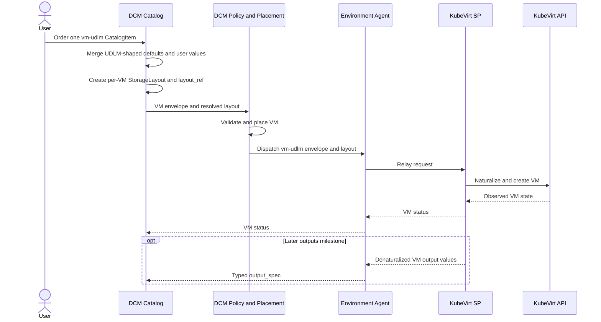

# Aligning DCM with UDLM

## Open Questions

1. Should DCM start with two VM ServiceTypes: the current `vm` for OSAC and a
   new `vm-udlm` for KubeVirt? The proposal and JSON below show this option, but
   it is not a final decision. OSAC must keep working.
2. The JSON example below uses `dcm/storage-layouts/vm-123` as a sample
   `layout_ref`. Where will DCM store each VM's `StorageLayout`, and how will
   DCM resolve the real reference?
3. How will KubeVirt provide boot and data disks at the sizes requested in the
   layout?
4. When a VM is deleted, should its disks be deleted or kept? UDLM puts this
   choice on `Volume.retain_on_release`, not on `StorageLayout`.
5. Should the shared SDK types go in `dcm-project/service-provider-api` or a new
   repository?

### Related Jira Tickets

| Ticket                                                                                                                                                                                         | Relation                                                 |
| ---------------------------------------------------------------------------------------------------------------------------------------------------------------------------------------------- | -------------------------------------------------------- |
| [FLPATH-4436](https://redhat.atlassian.net/browse/FLPATH-4436)                                                                                                                                 | Epic: align DCM types with UDLM                          |
| [FLPATH-4793](https://redhat.atlassian.net/browse/FLPATH-4793)                                                                                                                                 | This enhancement                                         |
| [FLPATH-4654](https://redhat.atlassian.net/browse/FLPATH-4654)                                                                                                                                 | Test the alignment                                       |
| [FLPATH-4491](https://redhat.atlassian.net/browse/FLPATH-4491)                                                                                                                                 | Finalize UDLM; v1 proceeds against pinned schemas        |
| [FLPATH-4298](https://redhat.atlassian.net/browse/FLPATH-4298), [FLPATH-4748](https://redhat.atlassian.net/browse/FLPATH-4748), [FLPATH-4749](https://redhat.atlassian.net/browse/FLPATH-4749) | Coordinate VM output definitions and delivery            |
| [FLPATH-4767](https://redhat.atlassian.net/browse/FLPATH-4767)                                                                                                                                 | KubeVirt SP transport work; separate from the data model |

## Summary

Use UDLM `Machine.VM` and `StorageLayout` from the catalog through placement to
the KubeVirt Service Provider. One proposed transition adds `vm-udlm` beside the
existing `vm` ServiceType so OSAC can keep using its current request. Whether
both types launch together is still open. Align observed KubeVirt VM outputs
through DCM's shared outputs path in a separate delivery milestone.

## Motivation

DCM's current `vm` ServiceType uses `vcpu` and `storage.disks[]`. UDLM uses
`Machine.VM.spec.cpu` and a separate `StorageLayout.spec.entries[]`. OSAC still
needs the current DCM VM request. The proposed separate `vm-udlm` ServiceType
would let KubeVirt use the UDLM contract without breaking OSAC. Under that
option, the formats coexist with separate catalog defaults, policies, and
provider routing.

The VM request still needs DCM information. `service_type` routes the request,
and `metadata` identifies the DCM resource. These fields belong in a DCM
envelope, not in the UDLM `Machine.VM` spec. The existing OSAC `vm` request
keeps `provider_hints.osac`; the proposed KubeVirt `vm-udlm` v1 request does not
define or accept `provider_hints`.

### Goals

- Use the pinned UDLM `Machine.VM` spec for the KubeVirt VM path from
  CatalogItem resolution through policy, placement, and dispatch.
- Keep the current OSAC VM request usable during the transition. If the two
  ServiceTypes are chosen, keep `vm` for OSAC and use `vm-udlm` for KubeVirt,
  with no cross-routing.
- Reject a VM request if no available provider supports its contract.
- Let one VM CatalogItem define UDLM VM fields and inline disk-layout defaults.
  Create one UDLM `StorageLayout` record per ordered VM and set `layout_ref`.
- Validate the VM, layout, and reference before dispatch. The provider must
  honor requested disk sizes or reject the request.
- Naturalize UDLM VM and layout data inside KubeVirt SP. Denaturalize observed
  VM data to UDLM-aligned output values as the outputs path supports them.
- Use shared SDK types for the pinned UDLM contracts and SP boundary.

### Non-Goals

- Changing OSAC SP in v1 or adding VMware and other SPs to the UDLM VM path.
- Creating a second user-facing CatalogItem for the VM's disk layout.
- Adding `entries[]` inside `Machine.VM`; UDLM defines them on `StorageLayout`.
- Replacing DCM's catalog, policy engine, placement, or transport with UDLM.
- Defining a new UDLM type. Any needed UDLM schema change is a separate,
  versioned dependency.

## Proposal

The sections below describe **Candidate A: two ServiceTypes**. This is a
proposed transition, not a decision. Open Question 1 must be resolved before
implementation. If another option is chosen, revise the ServiceType name,
examples, routing, tests, and rollout plan together. The UDLM VM and layout
contract does not depend on that choice.

### Contract and ownership

Under Candidate A, DCM would add a `vm-udlm` ServiceType with a DCM envelope.
The existing `vm` ServiceType and its schema would stay available for OSAC:

| Part                                                                     | Owner                     | Purpose                                                 |
| ------------------------------------------------------------------------ | ------------------------- | ------------------------------------------------------- |
| `service_type`, `metadata`                                               | DCM                       | Routing and name/labels                                 |
| `machine_vm`                                                             | UDLM `Machine.VM.spec`    | Portable VM request, including `layout_ref`             |
| `storage_layout.spec`                                                    | UDLM `StorageLayout.spec` | Inline catalog input for named, sized disks             |
| `machine_vm_schema_id`, `storage_layout.ref`, `storage_layout.schema_id` | DCM                       | Pinned schemas and resolved layout identity at dispatch |

The names `machine_vm` and `storage_layout` are **proposed DCM envelope
fields**. They do not exist in today's DCM API. `machine_vm` follows the pinned
UDLM VM spec. `storage_layout.spec` follows the pinned UDLM layout spec;
`machine_vm_schema_id`, `storage_layout.ref`, and `storage_layout.schema_id` are
DCM envelope fields, not UDLM spec fields. At catalog authoring time, the
`vm-udlm` catalog author supplies VM defaults and `storage_layout.spec.entries`
only. `machine_vm.layout_ref`, both schema IDs, and `storage_layout.ref` are
system-generated: they must be absent from CatalogItem fields and user values.
The authoring schema allows them to be absent; the resolved dispatch schema
requires them. At order time, DCM creates a separate layout record for that VM
and fills both references and schema IDs. The layout record is not another
CatalogItem or a DCM `storage` ServiceType.

One layout record belongs to one VM. The CatalogItem is the reusable template;
ordered VMs do not share a mutable layout record. DCM stores the layout and its
resolved identity with the VM request so later catalog edits cannot change an
existing VM's disks. Before dispatch, DCM resolves `layout_ref` to exactly one
layout and sends both UDLM specs, the same resolved reference, and both pinned
schema IDs to KubeVirt SP in the DCM envelope. The provider rejects a reference
or either schema mismatch. DCM must add `vm-udlm` to its allowed ServiceType
names and public schema. KubeVirt advertises `vm-udlm` through the Environment
Agent, while OSAC keeps its direct control-plane registration for `vm`.
Validation, placement, dispatch, retry, and fallback must match the exact
ServiceType. If no compatible ready provider is available, the request fails; it
must never cross to the other VM contract.

### Candidate A: parallel VM ServiceTypes during transition

The existing `vm` ServiceType keeps the DCM VM schema, OSAC CatalogItems, and
legacy policy paths. The new `vm-udlm` ServiceType has separate KubeVirt
CatalogItems and UDLM policy paths. A CatalogItem names one ServiceType, so DCM
validates and places each request against its own schema. The provider receives
that same format. OSAC's `cluster` contract is unchanged.

Both providers can run in one DCM deployment only if placement and both dispatch
paths preserve these exact service-type capabilities. A missing provider or
empty capability list must not bypass this check or cause fallback across the
two VM types. Users will see two VM types during the transition. Moving OSAC to
UDLM and retiring legacy `vm` are later decisions, not part of this v1 change.

The layout ID must be stable for retries of the same VM order. DCM must not
dispatch until the layout is saved and bound to that VM. If an order fails
before dispatch, DCM must remove an unused layout or make a retry reuse it.
Deleting a VM must also settle ownership of its layout and any realized volumes;
volume data retention remains the open decision above.

### Candidate A: parallel VM paths

| Concern                         | Legacy `vm` (OSAC)                            | New `vm-udlm` (KubeVirt)                                             |
| ------------------------------- | --------------------------------------------- | -------------------------------------------------------------------- |
| VM fields in catalog and policy | DCM `vcpu`, `storage.disks`                   | UDLM `machine_vm.cpu`, `storage_layout.spec.entries`                 |
| Disk defaults                   | Inline `storage.disks` on an OSAC CatalogItem | Inline `storage_layout.spec.entries` on a KubeVirt CatalogItem       |
| Disk identity after order       | Disk names in VM spec                         | Per-VM `StorageLayout` and `Machine.VM.layout_ref`                   |
| Provider mapping                | DCM VM fields to OSAC                         | UDLM VM and layout specs to KubeVirt                                 |
| Provider result                 | Existing OSAC status behavior                 | Status at launch; typed `output_spec` in the later outputs milestone |

### Field comparison between separate contracts

These fields belong to different ServiceTypes. Existing `vm` fields stay as they
are.

| Legacy `vm` field          | New `vm-udlm` field                  | Rule                                                 |
| -------------------------- | ------------------------------------ | ---------------------------------------------------- |
| `vcpu.count`               | `machine_vm.cpu.count`               | Legacy field stays on `vm`                           |
| `memory.size`              | `machine_vm.memory.size`             | Use UDLM quantity validation                         |
| `guest_os.type`            | `machine_vm.guest_os.type`           | Keep OS selection in the VM spec                     |
| `storage.disks[].name`     | `storage_layout.spec.entries[].name` | Stable per-layout disk identity                      |
| `storage.disks[].capacity` | `storage_layout.spec.entries[].size` | Honor the requested size                             |
| Disk named `boot`          | Entry with `role: "boot"`            | `role` is optional in UDLM; set it for the boot disk |
| No layout reference        | `machine_vm.layout_ref`              | DCM fills it after creating the per-VM layout        |
| `service_type`, `metadata` | Same DCM envelope fields             | Keep outside the UDLM VM spec                        |
| `provider_hints.osac`      | Not used in `vm-udlm` v1             | Retain only for legacy OSAC `vm` requests            |

### Candidate A example: one KubeVirt VM CatalogItem

This **proposed** JSON assumes Candidate A. It follows the current DCM pattern:
the catalog author fixes the disk list; the user may change the VM name. A
CatalogItem may make other fields editable later. `fields[].path` must be valid
against the new DCM VM envelope schema.

```json
{
  "api_version": "v1alpha1",
  "display_name": "Development VM",
  "spec": {
    "resources": [
      {
        "name": "vm",
        "service_type": "vm-udlm",
        "fields": [
          { "path": "metadata.name", "editable": true, "default": "web-01" },
          { "path": "machine_vm.cpu.count", "editable": false, "default": 2 },
          {
            "path": "machine_vm.memory.size",
            "editable": false,
            "default": "8Gi"
          },
          {
            "path": "machine_vm.guest_os.type",
            "editable": false,
            "default": "rhel-9"
          },
          {
            "path": "storage_layout.spec.entries",
            "editable": false,
            "default": [
              { "name": "root", "size": "50Gi", "role": "boot" },
              { "name": "data", "size": "100Gi" }
            ]
          }
        ]
      }
    ]
  }
}
```

Assume DCM returns the CatalogItem UID `catalog-item-123`. The user orders this
**one** `vm-udlm` CatalogItem by that UID. No separate storage order is needed.
The order request is:

```json
{
  "api_version": "v1alpha1",
  "display_name": "Web VM",
  "spec": {
    "catalog_item_id": "catalog-item-123",
    "user_values": [
      { "resource": "vm", "path": "metadata.name", "value": "web-01" }
    ]
  }
}
```

An OSAC CatalogItem instead continues to use `service_type: vm` and legacy DCM
field paths such as `vcpu.count` and `storage.disks`.

### Candidate A example: resolved VM request

After catalog resolution, DCM creates a `StorageLayout` record with those
`entries`. It fills `layout_ref` with a resolvable path to that record. The
following **proposed** dispatch envelope shows both specs. The sample path is
illustrative; its namespace, pin, and lookup API still need to be agreed.

```json
{
  "service_type": "vm-udlm",
  "metadata": { "name": "web-01" },
  "machine_vm_schema_id": "https://udlm.dev/registry/udlm/0.1/Machine.VM/2.1.0",
  "machine_vm": {
    "cpu": { "count": 2 },
    "memory": { "size": "8Gi" },
    "guest_os": { "type": "rhel-9" },
    "layout_ref": "dcm/storage-layouts/vm-123"
  },
  "storage_layout": {
    "ref": "dcm/storage-layouts/vm-123",
    "schema_id": "https://udlm.dev/registry/udlm/0.1/StorageLayout/0.7.0",
    "spec": {
      "entries": [
        { "name": "root", "size": "50Gi", "role": "boot" },
        { "name": "data", "size": "100Gi" }
      ]
    }
  }
}
```

The proposed `vm-udlm` v1 envelope does not accept `provider_hints`. Legacy OSAC
`vm` requests keep `provider_hints.osac`. The provider checks that
`storage_layout.ref` matches `layout_ref`, that both schema IDs are supported,
and that the disk sizes can be fulfilled. It never silently substitutes a
different size. The example illustrates the target contract; current KubeVirt SP
cannot yet fulfill these sizes.

### VM request and result flow



### User Stories

#### Story 1: Order a VM

A user chooses one `vm-udlm` CatalogItem and sets only fields the catalog author
made editable. The user does not create a layout record or write `layout_ref`.
An OSAC user can still order a legacy `vm` CatalogItem.

#### Story 2: Apply VM policy

A policy author for `vm-udlm` reads the same UDLM-shaped VM fields that KubeVirt
SP receives. For example, CPU policy reads `machine_vm.cpu.count`. Existing `vm`
policies retain their DCM field paths. DCM still uses `service_type`, metadata,
and placement context for its own decisions.

#### Story 3: Read VM outputs

A user reads the VM's status and typed output values, such as `primary_ip` and
`hostname`, through DCM after the output milestone lands. The provider supplies
these values after observing the VM; they are not predicted from the request.

### Implementation Details/Notes/Constraints

- Add `vm-udlm` to the DCM allowed ServiceType names and public API schema. Add
  its catalog defaults, policies, seed data, and generated API clients. Keep the
  existing `vm` schema, OSAC CatalogItems, and policy paths unchanged. Check UI,
  CLI, status, and outputs code for assumptions that every VM has the literal
  `service_type: vm`.
- Define and validate the DCM VM envelope. Its `machine_vm` and
  `storage_layout.spec` fields embed the pinned UDLM **spec** shapes. Keep DCM
  identity fields outside those specs; do not loosen UDLM validation.
- Create, persist, resolve, and pin one layout record for each ordered VM.
  Reject missing, ambiguous, stale, wrong-owner, or malformed references;
  duplicate entry names; and layouts unsupported by the provider before
  realization. Retries must reuse the same layout identity.
- Accept catalog defaults only on declared fields and user values only on
  editable fields. Reject client-supplied `layout_ref`, layout identity, or
  schema IDs. Require them in the resolved dispatch envelope and reject either
  schema-version mismatch.
- KubeVirt SP naturalizes the VM and resolved layout into KubeVirt resources.
  Its current implementation does not honor requested disk capacities; v1 must
  fix this or reject unsupported layouts. Boot-disk source, size, and lifecycle
  need an explicit supported contract. An unknown guest OS must fail instead of
  silently selecting a different image.
- The Environment Agent remains a relay for KubeVirt and advertises `vm-udlm`.
  OSAC keeps its direct control-plane SP registration for `vm`; its future agent
  migration is separate. Both dispatch paths must check the exact service type.
  Registration, retry, and fallback must not silently route either request to a
  provider of the other type.
- Reuse the typed `output_spec` status path proposed in
  [cross-provider-outputs PR #99](https://github.com/dcm-project/enhancements/pull/99).
  Define VM output fields against the pinned UDLM `Machine.VM` names:
  `provider_handle`, `primary_ip`, `hostname`, `ip_addresses`, `mac_addresses`,
  `observed_run_state`, and `target_segment`. Adding all these observed values
  is a separate milestone, not a prerequisite for the `vm-udlm` launch. Do not
  invent a value KubeVirt cannot observe.
- UDLM `StorageLayout` describes disk shape, not volume retention. Any v1
  promise about preserving data after VM deletion needs a separate Volume and
  provider lifecycle rule. Do not infer retention from `layout_ref`.
- A missing or empty ready-provider list must not skip service-type capability
  checks for `vm-udlm`; reject the request instead of sending it to OSAC.

### Risks and Mitigations

| Risk                                                                 | Mitigation                                                                          |
| -------------------------------------------------------------------- | ----------------------------------------------------------------------------------- |
| A legacy `vm` policy is applied to `vm-udlm` or vice versa           | Scope policies by exact ServiceType; test a rejecting policy for each path          |
| Catalog defaults or user values mix the two VM shapes                | Validate each CatalogItem against its own ServiceType schema                        |
| A request reaches the wrong provider, including during fallback      | Match exact advertised ServiceType at placement and dispatch; fail closed           |
| An empty ready-agent list bypasses capability validation             | Require a compatible ready provider for `vm-udlm` before dispatch                   |
| UI, CLI, or outputs omit `vm-udlm` because they check only `vm`      | Audit VM-specific filters, views, and output paths for both ServiceTypes            |
| `layout_ref` is missing, ambiguous, or points to another VM's layout | Resolve one pinned layout for this VM before dispatch; reject mismatches            |
| KubeVirt ignores requested size or boot role                         | Test realized disks against entries; reject unsupported requests                    |
| Deletion loses data users expected to keep                           | Specify Volume retention and KubeVirt deletion behavior before claiming persistence |
| UDLM changes after implementation starts                             | Pin schema IDs and commit; review and test each version bump                        |
| VM outputs conflict with the outputs enhancement                     | Reuse its typed `output_spec` and align definitions to pinned UDLM names            |

## Design Details

### Work sequence

If Candidate A is selected:

1. Pin UDLM schemas and define the DCM VM envelope and layout-reference rule.
2. Add `vm-udlm` to allowed ServiceType names and define its schema, CatalogItem
   paths, policies, defaults, and clients. Preserve the legacy `vm` path.
3. Make catalog resolution create one layout per VM and give `Machine.VM` a
   resolvable `layout_ref`. Validate and pass both specs through placement.
4. Update the shared SDK contract and KubeVirt SP to advertise and accept only
   `vm-udlm`. Keep OSAC on `vm`. Naturalization must honor supported layout
   entries. Output population follows the outputs work.
5. Verify both VM paths and cross-routing failure cases before rollout.

### Versioning

Pin `udlm/0.1` at commit `ecf0f290cf6dc9f06d7580792fc03b903890934a`, with these
generated schema IDs:

- `https://udlm.dev/registry/udlm/0.1/Machine.VM/2.1.0`
- `https://udlm.dev/registry/udlm/0.1/StorageLayout/0.7.0`

The schema version is per class; `udlm/0.1` is not the `Machine.VM` version.
Record both IDs and the immutable commit in the SDK and DCM dependency. A later
UDLM change requires a coordinated version bump and validation run.

### Testing Strategy

These checks describe Candidate A. UDLM validation, layout, and KubeVirt
fulfillment checks are needed under either transition design. If the team
chooses another way to keep OSAC working, revise the provider-isolation tests
before implementation.

- Validate `vm` CatalogItems against the unchanged DCM schema and `vm-udlm`
  CatalogItems against the new UDLM envelope schema. Reject mixed fields.
  Confirm fixed layout entries cannot be overridden by users, and
  system-generated references and schema IDs cannot be supplied by users.
- Check separate policy paths for both ServiceTypes. Include a policy that must
  reject a request of each type so a missing Rego field cannot pass unnoticed.
- Check one layout per VM, stable reference resolution, and rejection of
  missing, ambiguous, stale, swapped, wrong-owner, empty-entry, duplicate-name,
  duplicate-boot, invalid-size, and unsupported layouts before dispatch. Test
  idempotent retry and cleanup of failed orders. Verify OSAC cannot receive a
  `vm-udlm` request.
- Verify the full CatalogItem → CatalogItemInstance → ServiceTypeInstance →
  KubeVirt flow for `vm-udlm`, plus a legacy `vm` order to OSAC. Run both paths
  in one deployment. Check OSAC's direct registration and KubeVirt's agent
  discovery, including re-registration, missing providers, empty ready-agent
  lists, retry, and no cross-type fallback. Check actual KubeVirt boot and data
  disks and sizes, not just the requested JSON. Check restart and deletion once
  retention is decided.
- Check naturalization against pinned schemas. Reject unknown guest OS and
  unsupported storage tiers instead of silently choosing defaults. Check
  `vm-udlm` v1 rejects provider hints, while legacy OSAC hints still work.
  Reject either schema ID when it does not match the pinned version. Verify
  status when `vm-udlm` launches and, separately, populated UDLM output fields
  as the outputs milestone lands. Verify existing OSAC status and output
  behavior remains unchanged.

### Upgrade / Downgrade Strategy

DCM is in development, with no saved VM requests requiring data migration. Under
Candidate A, add the `vm-udlm` schema, catalog and policy path, SDK support, and
KubeVirt SP alongside the unchanged legacy `vm` path for OSAC. Do not route an
order until its exact provider capability is available. During rollback, stop
new `vm-udlm` orders and settle any already created KubeVirt VMs before removing
its schema or provider; legacy OSAC `vm` orders continue. Do not send either
request to the other path. If Candidate A is not selected, revise this plan.

## Implementation History

N/A — this enhancement has not been implemented.

## Drawbacks

This needs a coordinated change across catalog, policy, placement, SDK, and
KubeVirt SP before the new VM request works. DCM must also own the identity and
lifecycle of a per-VM layout record. Candidate A would keep two VM schemas,
CatalogItems, and policy paths until OSAC migrates. That costs more maintenance
than a single immediate cutover, but keeps OSAC VM ordering available.

## Alternatives

### Alternative 1: Translate DCM VM requests at dispatch

#### Description

Keep `vcpu` and `storage.disks[]` in the catalog and policy path. Convert the
request to UDLM immediately before sending it to KubeVirt SP.

#### Pros

- Changes fewer upstream components at first.
- Existing DCM VM field paths remain usable during the transition.

#### Cons

- DCM and UDLM VM formats coexist and need repeated validation.
- Disk conversion is structural: a flat disk list becomes a separate layout
  record and reference.
- A temporary translator can become a permanent contract boundary.

#### Status

Rejected for v1.

#### Rationale

OSAC still needs the legacy DCM VM request. Both transition candidates can keep
that request while KubeVirt CatalogItems start with UDLM fields. Converting only
at dispatch would leave the KubeVirt catalog and policies on the old VM shape,
which does not meet the goal of UDLM-aligned requests across DCM.

### Alternative 2: Put disk entries inside Machine.VM

#### Description

Add `entries[]` directly to `Machine.VM` and avoid a separate layout record.

#### Pros

- One object would hold the whole VM request.
- No reference would need resolution.

#### Cons

- The pinned UDLM `Machine.VM` schema has `layout_ref`, not inline `entries`.
- This would require a UDLM schema change and a new version before DCM could use
  it.

#### Status

Rejected for this enhancement.

#### Rationale

Using the existing `StorageLayout` contract keeps the VM request compatible with
pinned UDLM schemas and leaves disk shape distinct from the VM spec.

### Candidate B: Version both contracts under `service_type: vm`

#### Description

Keep one public `vm` ServiceType name but require a contract identifier on each
CatalogItem and provider. Use it to choose the schema, policy paths, and
compatible provider.

#### Pros

- Users would see one VM type.
- Provider capabilities could express contract versions directly.

#### Cons

- The catalog currently resolves one schema by ServiceType name, so validation
  and resolution would need a larger redesign.
- Every placement, retry, and fallback path would need version-aware checks.

#### Status

Under consideration while Open Question 1 is unresolved.

#### Rationale

This would keep one public VM type, but DCM currently resolves one schema by
ServiceType name and filters providers by ServiceType. It therefore requires
version-aware catalog validation and routing. Candidate A is easier to isolate
and verify, but neither candidate has been selected yet.

## Infrastructure Needed

No new runtime infrastructure is required. DCM needs storage and reference
resolution for per-VM layout records, plus shared SDK packaging. The SDK
repository choice remains open.
